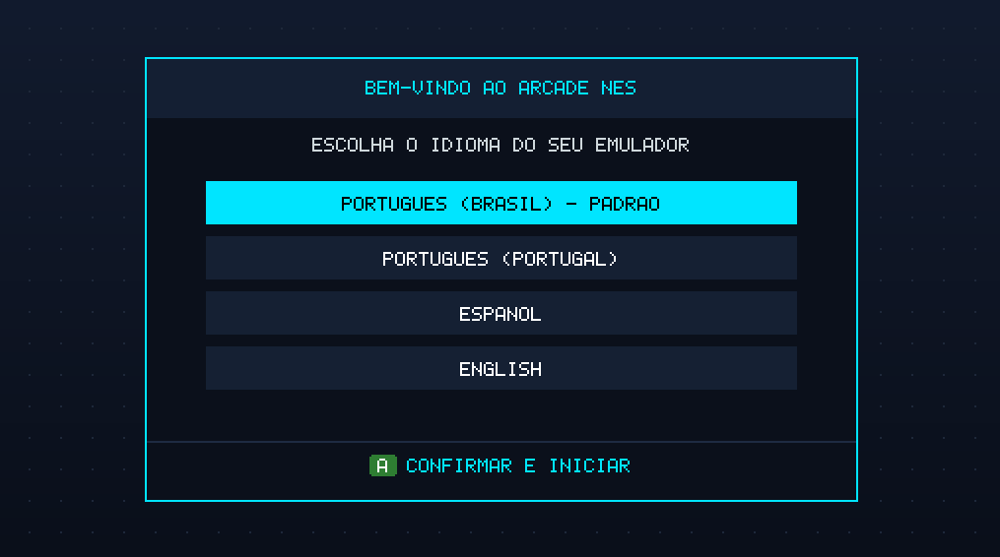
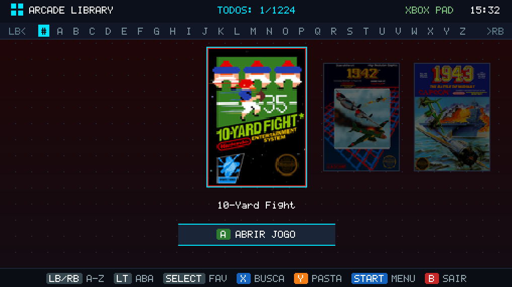
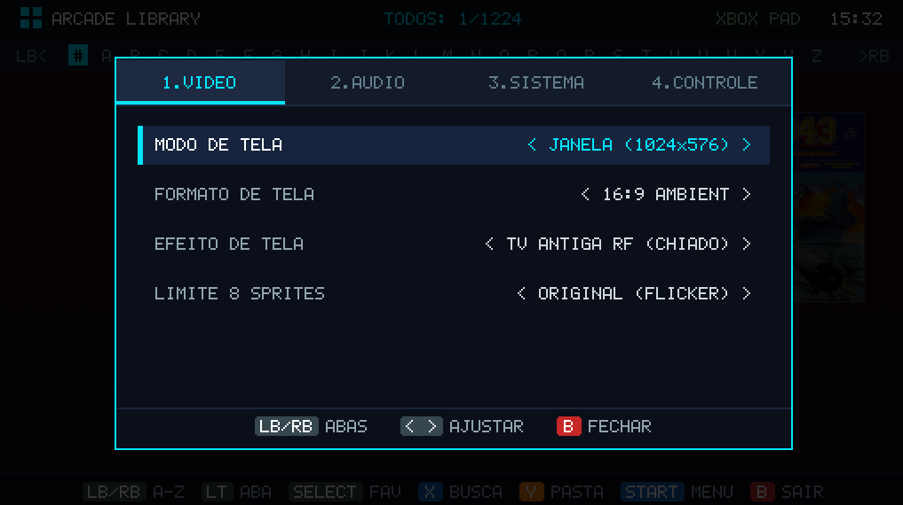
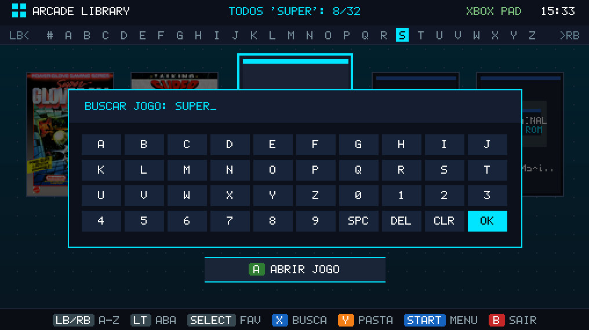

# PEngine

Emulador de NES escrito em Rust, com uma biblioteca visual de jogos, navegação por controle e teclado, opções de vídeo e áudio, slots de save state e rewind.

> **Importante sobre ROMs:** este repositório não contém nenhuma ROM de jogo. O PEngine também não baixa nem distribui ROMs. Para jogar, cada pessoa precisa fornecer seus próprios arquivos `.nes` e é responsável por ter o direito de usá-los de acordo com as regras aplicáveis em seu local.

## Recursos

- Biblioteca visual para localizar e selecionar jogos `.nes`.
- Busca por nome, navegação alfabética, favoritos e lista de jogos recentes.
- Controles por teclado e gamepad Xbox compatível com XInput.
- Modos de janela, sem bordas e tela cheia; opções de proporção e scanlines.
- Volume, mute, turbo, save states e rewind.
- Arquivos de bateria dos jogos salvos pelo emulador quando aplicável.

A compatibilidade varia conforme o jogo e o mapper usado. Alguns recursos de mappers avançados ainda estão em desenvolvimento.

## Capturas de tela

### Seleção de idioma



### Biblioteca de jogos



### Opções de vídeo



### Busca de jogos



## ROMs: use seus próprios arquivos

Nenhum jogo vem incluído com o PEngine. Não coloque ROMs no repositório nem espere que o emulador as baixe.

No Windows, o PEngine cria e procura jogos nesta pasta:

```text
%USERPROFILE%\Documents\PEngine\roms
```

Coloque nessa pasta os arquivos `.nes` que você tem autorização para usar. Também é possível pressionar **F1** no Hub para escolher outra pasta de ROMs. O emulador aceita arquivos `.nes`; arquivos ZIP devem ser extraídos antes do uso.

## Requisitos

- Windows 10 ou posterior recomendado.
- Rust e Cargo instalados pelo [rustup](https://rustup.rs/).
- Para compilar no Windows, ferramentas de compilação C/C++ do Visual Studio (Build Tools) podem ser necessárias para dependências de áudio.
- Um dispositivo de saída de áudio é opcional; sem ele, o emulador tenta continuar sem áudio.

## Compilar e executar

Abra um terminal nesta pasta do projeto e execute:

```powershell
cargo run --release
```

Para apenas compilar:

```powershell
cargo build --release
```

O binário gerado pelo Cargo fica em `target\release\rust_nes.exe`. O arquivo `PEngine.exe` distribuído separadamente é um build local e não faz parte deste repositório.

## Controles

### Hub

| Ação | Teclado | Gamepad Xbox |
|---|---|---|
| Navegar pela biblioteca | Setas | Direcional ou analógico esquerdo |
| Abrir/confirmar | Enter ou Z | A |
| Voltar | Esc | B |
| Alternar favorito | F | Select/Back |
| Buscar | F2 | X |
| Escolher pasta de ROMs | F1 | Y |
| Abrir opções | F3 | Menu/Start |
| Trocar categoria | Tab | LT |
| Saltar entre letras | Page Up / Page Down | LB / RB |

### Durante o jogo

| Ação NES | Teclado | Gamepad Xbox |
|---|---|---|
| A / B | Z / X | A / B (Y e X também funcionam como A e B durante o jogo) |
| Select / Start | Shift direito / Enter | Back / Start |
| Direcional | Setas | Direcional ou analógico esquerdo |
| Pausar e abrir menu | Esc | Segurar Start |
| Reiniciar | F2 | — |
| Salvar estado | F5 | Menu do jogo |
| Carregar estado | F8 | Menu do jogo |
| Rebobinar | Backspace | Segurar LT |
| Turbo | Segurar Tab | Segurar RB ou RT |
| Alternar janela/tela cheia | F11 ou Alt+Enter | — |

Os slots de save state podem ser escolhidos no menu de pausa. Os saves de bateria, as estatísticas, as configurações e os estados são dados locais do usuário e não são necessários para compilar o projeto.

## Licença

O código do PEngine está sob a licença [MIT](LICENSE). A licença do código não inclui direitos sobre jogos, ROMs, capas ou outros materiais de terceiros.
